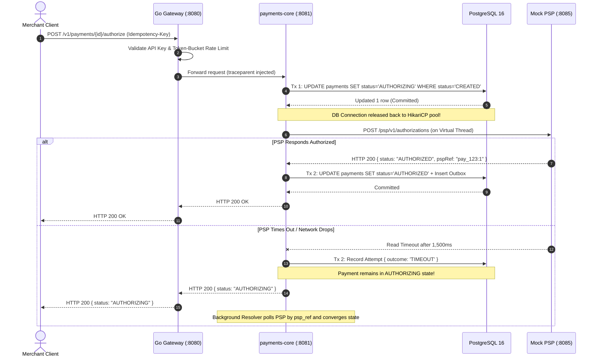
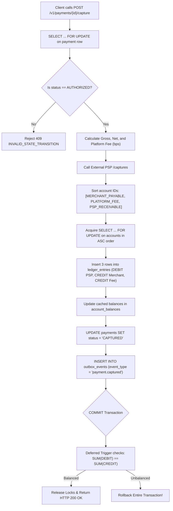
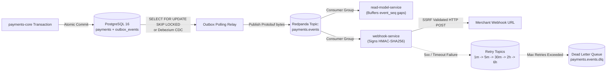

# PayCore Ledger — Production-Grade Payment Orchestration & Double-Entry Ledger Engine

[](https://github.com/Juixe7/Paycore-Ledger/actions/workflows/ci.yml)
[](LICENSE)
[](https://openjdk.org/projects/jdk/21/)
[](https://go.dev/)
[](https://spring.io/projects/spring-boot)
[](https://www.postgresql.org/)
[](https://redpanda.com/)
[](http://localhost:3001)

---

## 1. Executive Summary

### 1.1 Core Problem Statement
Modern payment platforms (such as Stripe, Adyen, and Razorpay) operate in an environment of asynchronous, unreliable external third-party Payment Service Providers (PSPs), flaky networks, and pathological concurrent retry traffic. Conventional CRUD architectures built on top of traditional Object-Relational Mapping (ORM) frameworks fail catastrophically in this domain due to:
1. **Financial Drift & Non-Auditable Mutations**: Storing balances as mutable scalar columns (`account_balance = account_balance + ?`) allows silent data corruption, rounding drift, and zero cryptographic or mathematical audit trails.
2. **Connection Pool Starvation**: Holding database connections open across slow, blocking external PSP HTTP roundtrips (100 ms – 2,000 ms) exhausts database connection pools (HikariCP), stalling unrelated transactions and leading to cascading platform-wide outages.
3. **Concurrent Over-Refund and Double-Charge Race Conditions**: High-frequency parallel client retries or simultaneous refund attempts bypass naive application-level checks, resulting in duplicate charges or cumulative refunds exceeding 100% of captured transaction amounts.
4. **Dual-Write Discrepancies**: Publishing events to message brokers (Kafka) and updating database records independently introduces distributed inconsistencies when either step fails midway.

### 1.2 Technical Philosophy & Invariants
**PayCore Ledger** is an enterprise-grade payment orchestration and double-entry bookkeeping engine designed around strict mathematical invariants, defensive database primitives, and explicit concurrency control:
* **Strict Double-Entry Invariant**: Every monetary movement is an immutable journal transaction where $\sum \text{Debits} \equiv \sum \text{Credits}$ within the same currency. Global ledger drift must evaluate to exactly $0\text{ paise}$ at all times.
* **Non-Blocking External I/O**: Database connections are released prior to initiating network I/O with upstream acquirers. Long-running PSP network calls are executed on JDK 21 Virtual Threads isolated by Resilience4j Bulkheads and Circuit Breakers.
* **Database-Enforced Guardrails**: Correctness does not rely solely on application code. Integrity is anchored at the database engine level via deferred constraint triggers, check constraints, append-only mutation blocks, and lexicographically sorted pessimistic row locks (`SELECT ... FOR UPDATE`).
* **Authoritative Idempotency & Guaranteed Event Delivery**: Distributed requests are protected via cryptographic request payload hashing and transactional outbox tables committed atomically alongside domain state changes.

### 1.3 High-Level Technology Matrix

| Layer / Concern | Technology Stack | Architectural Purpose |
| :--- | :--- | :--- |
| **Edge Ingress Gateway** | Go 1.22 (`net/http/httputil`) | Low-latency reverse proxy, SHA-256 API key authentication, per-merchant token-bucket rate limiting, W3C `traceparent` propagation. |
| **Domain Orchestration** | Java 21, Spring Boot 3.3.5 | Virtual Threads (`Thread.ofVirtual()`), Spring `JdbcClient` (zero ORM magic), HikariCP connection management. |
| **Data Persistence** | PostgreSQL 16 | Partitioned tables (monthly ranges), PL/pgSQL deferred constraint triggers, composite B-Tree indexes, row-level locks. |
| **Event Streaming** | Redpanda (Kafka 3.x compatible), Protobuf v3 | High-throughput transactional outbox CDC streaming with backward-compatible binary serialization. |
| **Caching & In-Flight Locks** | Redis 7 | Sub-millisecond idempotent response caching and fast-path request deduplication. |
| **Fault Tolerance & Resilience** | Resilience4j 2.2.0 | Time-limited bulkheads, circuit breakers, backoff retry queues, and Dead Letter Queues (DLQ). |
| **Observability & Metrics** | Prometheus, Grafana, OpenTelemetry, Jaeger | Custom Micrometer gauges (`ledger_drift_paise`), HTTP latency distribution (p50/p95/p99), and distributed W3C tracing. |

---

## 2. Architecture Overview

### 2.1 Layered Architectural Diagram

```text
 ┌────────────────────────────────────────────────────────────────────────────────────────┐
 │                                CLIENT / MERCHANT APPLICATION                           │
 └───────────────────────────────────────────┬────────────────────────────────────────────┘
                                             │ HTTP/1.1 (X-API-Key, X-Idempotency-Key)
                                             ▼
 ┌────────────────────────────────────────────────────────────────────────────────────────┐
 │                      TIER 1: EDGE INGRESS GATEWAY (Go 1.22, :8080)                     │
 │  • Token-Bucket Rate Limiter (sync.Map)          • API Key SHA-256 Auth & Routing      │
 │  • Idempotency Header Validation                 • W3C Traceparent Header Injection    │
 └───────┬───────────────────────────────────┬────────────────────────────────────┬───────┘
         │ /v1/payments, /v1/payouts         │ /v1/views/payments                 │ /v1/recon
         ▼                                   ▼                                    ▼
 ┌───────────────────────────────┐ ┌───────────────────────────────┐ ┌────────────────────┐
 │  TIER 2: PAYMENTS-CORE        │ │  TIER 4A: READ-MODEL-SERVICE  │ │  TIER 4B: RECON    │
 │  (Java 21, :8081)             │ │  (Java 21, :8083)             │ │  (Java 21, :8084)  │
 │  • Two-Phase Authorization    │ │  • CQRS Query Views           │ │  • CSV Ingestion   │
 │  • Double-Entry Ledger Engine │ │  • Out-of-Order Gap Buffer    │ │  • 4-Way Match     │
 │  • Idempotency Engine         │ │  • Deterministic Rebuild      │ │  • Discrepancy Log │
 └───────┬──────────────┬────────┘ └───────────────▲───────────────┘ └─────────┬──────────┘
         │              │                          │                           │
         │ External I/O │ PostgreSQL ACID          │ Kafka Payment Events      │ Matches
         ▼ (No DB Lock) ▼ Transaction              │ (Protobuf)                │ Against
 ┌───────────────┐ ┌───────────────────────────────┴───────────────┐           │
 │ MOCK PSP      │ │  TIER 3: DATA PERSISTENCE (PostgreSQL 16)     │           │
 │ (:8085)       │ │  • payments (Mutable Aggregate Root)          │           ▼
 │ • Hold/Capture│ │  • ledger_entries (Append-Only Partitioned)   │ ┌────────────────────┐
 │ • Fault Inject│ │  • accounts & account_balances (Sharded)      │ │ PSP SETTLEMENT     │
 │ • Webhook Ets │ │  • outbox_events (Transactional Outbox)       │ │ CSV FILE (T+1)     │
 └───────────────┘ └───────────────────────────────┬───────────────┘ └────────────────────┘
                                                   │ Polling Relay / CDC
                                                   ▼
 ┌────────────────────────────────────────────────────────────────────────────────────────┐
 │             TIER 5: ASYNC EVENT BROKER & WEBHOOKS (Redpanda & Webhook Engine)          │
 │  • Topic: payments.events (Protobuf v1)          • webhook-service (:8082)             │
 │  • Retry Topics: 1m, 5m, 30m, 2h, 6h             • HMAC-SHA256 Signature Generation   │
 │  • Dead Letter Queue (payments.events.dlq)       • SSRF Safe IP Filter & Dispatch      │
 └────────────────────────────────────────────────────────────────────────────────────────┘
```

### 2.2 Separation of Concerns & Boundary Enforcement
1. **Modular Encapsulation**: Domain modules communicate exclusively via explicit domain boundaries. ArchUnit test suites ([`ArchitectureBoundaryTest.java`](payments-core/src/test/java/com/paycore/payments/ArchitectureBoundaryTest.java)) enforce compile-time verification: classes outside `com.paycore.payments.ledger` are strictly prohibited from referencing ledger entities or issuing direct queries against `ledger_entries`.
2. **Decoupled Read & Write Paths (CQRS)**: All mutating commands (Authorize, Capture, Refund, Payout) execute against `payments-core` using localized row-level locking. Read queries, statement projections, and merchant summaries are offloaded to `read-model-service`, preventing analytics queries from degrading transactional throughput.
3. **Transactional Outbox Event Sourcing**: Downstream consumers (Webhooks and Read Models) never query transactional tables directly. Changes are projected onto a reliable message bus via the transactional outbox pattern, preserving loose coupling and independent scalability.

---

## 3. Project Structure

### 3.1 Directory Tree

```text
Paycore/
├── .github/
│   └── workflows/
│       └── ci.yml                 # GitHub Actions verification pipeline (Protobuf, ArchUnit, Torture)
├── deploy/
│   ├── docker-compose.lite.yml    # Single-command infrastructure compose (Postgres, Redpanda, Redis, OTel)
│   └── observability/
│       ├── alerts.yml             # Prometheus ledger drift & outbox backlog alerting rules
│       ├── prometheus.yml         # Prometheus scrape configuration across all services
│       └── grafana/dashboards/    # Pre-provisioned PayCore overview dashboards
├── e2e-tests/                     # Testcontainers integration, chaos, and Toxiproxy test suites
├── formal/
│   └── PayCoreLedger.tla          # TLA+ formal specification of ledger invariants and state transitions
├── gateway/
│   ├── main.go                    # Go 1.22 Edge Gateway reverse proxy & token bucket implementation
│   ├── main_test.go               # Gateway unit and concurrency race-detector suite
│   └── go.mod                     # Go module definitions
├── mock-psp/                      # External acquirer simulator with configurable latency & fault injection
├── openapi/
│   ├── paycore-openapi.yaml       # OpenAPI 3.1 specification for core, gateway, and mock APIs
│   └── paycore.postman_collection.json # 11-folder Postman collection with invariant assertions
├── payments-core/                 # Primary transaction orchestrator and double-entry ledger
│   └── src/
│       ├── main/
│       │   ├── java/com/paycore/payments/
│       │   │   ├── idempotency/   # Authoritative database & Redis idempotency engine
│       │   │   ├── ledger/        # Double-entry ledger service, account sharding, invariant checks
│       │   │   ├── merchant/      # Merchant authentication filter and API key management
│       │   │   ├── outbox/        # Transactional outbox writer and polling publisher
│       │   │   ├── payment/       # Payment state machine, two-phase authorization, refund locks
│       │   │   └── psp/           # Resilient PSP HTTP client (Resilience4j Bulkhead & CircuitBreaker)
│       │   └── resources/
│       │       ├── application.yml
│       │       └── db/migration/  # Flyway SQL migrations (V1 schema, V2 shards, V3 statuses)
│       └── test/                  # ArchUnit boundaries, Concurrency & Crash torture suites
├── platform-common/               # Shared domain primitives across JVM modules
│   └── src/main/
│       ├── java/com/paycore/common/
│       │   ├── ids/UuidV7.java    # Millisecond-ordered UUIDv7 generator
│       │   ├── money/Money.java   # Minor-unit integer money arithmetic (paise)
│       │   └── tracing/           # W3C trace header constants
│       └── proto/                 # Canonical Protobuf event wire contracts (payment_events.proto)
├── read-model-service/            # CQRS Read-model projector with out-of-order gap buffering
├── reconciliation/                # Daily T+1 settlement CSV reconciliation & discrepancy engine
├── scripts/
│   └── run-live-demo.ps1          # Automated 7-step end-to-end interactive CLI demonstration
└── webhook-service/               # HMAC-SHA256 signing webhook dispatcher with SSRF guard and DLQ
```

### 3.2 Module Responsibility Matrix

| Module | Core Responsibility | Key Classes / Files |
| :--- | :--- | :--- |
| **`gateway`** | Edge reverse proxy, token bucket rate limiting, SHA-256 API key hashing, W3C tracing. | `gateway/main.go` |
| **`platform-common`** | Shared value objects (`Money`, `CurrencyCode`, `UuidV7`), Protobuf definitions. | `Money.java`, `payment_events.proto` |
| **`payments-core`** | State machine, two-phase authorization, 16-way sharded double-entry ledger, outbox relay. | `PaymentService.java`, `LedgerService.java` |
| **`webhook-service`** | HMAC-SHA256 signature signing, SSRF validation, tiered retry queues, dead letter queue. | `WebhookDeliveryService.java` |
| **`read-model-service`**| CQRS denormalization, `event_seq` gap buffer, offset-0 replay engine. | `ReadModelProjectorService.java` |
| **`reconciliation`** | Ingests external settlement CSV, performs 4-way classification (`MISSING_IN_LEDGER`, etc.). | `ReconciliationService.java` |
| **`mock-psp`** | Acquirer simulator with controllable fault modes (timeout, decline, 500, network drop). | `MockPspController.java` |

---

## 4. Core Features & Subsystems

### 4.1 Two-Phase Idempotent Authorization Pattern
To prevent connection-pool exhaustion while calling unpredictable third-party APIs, authorization is decoupled into two independent local transactions separated by non-blocking I/O:

```text
Client Request
      │
      ▼
┌────────────────────────────────────────────────────────┐
│ Phase 1: Local Transaction (requiresNewTx)            │
│ • State Transition: CREATED -> AUTHORIZING             │
│ • Assign deterministic psp_ref = payment_id + ":1"     │
│ • COMMIT & Release HikariCP DB Connection              │
└─────────────────────────────┬──────────────────────────┘
                              │ Connection returned to pool
                              ▼
┌────────────────────────────────────────────────────────┐
│ External PSP Network Call (On Virtual Thread)         │
│ • Resilience4j Bulkhead (max 256 calls)                │
│ • Resilience4j CircuitBreaker (sliding window 40)      │
│ • Configured Connect & Read Timeouts (1,500 ms)        │
└─────────────────────────────┬──────────────────────────┘
                              │ Execution resumes on completion/timeout
                              ▼
┌────────────────────────────────────────────────────────┐
│ Phase 2: Local Transaction (requiresNewTx)            │
│ • On Success: Advance to AUTHORIZED + emit outbox      │
│ • On Hard Decline: Advance to FAILED + emit outbox     │
│ • On Timeout: Remain in AUTHORIZING for Resolver sweep │
│ • COMMIT & Release HikariCP DB Connection              │
└────────────────────────────────────────────────────────┘
```

#### Code Implementation ([`PaymentService.java`](payments-core/src/main/java/com/paycore/payments/payment/PaymentService.java)):
```java
// Phase 1: Claim state atomically and release DB connection
AuthClaim claim = requiresNewTx.execute(status -> {
    Payment current = getPayment(merchantId, paymentId);
    current.status().requireTransitionTo(paymentId, PaymentStatus.AUTHORIZING, "authorize");
    String pspRef = paymentId + ":" + (countAttempts(paymentId) + 1);
    jdbcClient.sql("UPDATE payments SET status = 'AUTHORIZING', psp_ref = :ref WHERE id = :id AND status = 'CREATED'")
              .param("ref", pspRef).param("id", paymentId).update();
    return new AuthClaim(getPayment(merchantId, paymentId), attemptNo, pspRef, false);
});

// Non-blocking External I/O outside database transaction
PspClient.PspAuthResult pspResult = pspClient.authorize(new PspClient.PspAuthRequest(
        paymentId, merchantId, claim.attemptNo(), claim.pspRef(), claim.payment().amount(), claim.payment().currency()));

// Phase 2: Finalize state based on PSP outcome
requiresNewTx.execute(status -> {
    if (pspResult.outcome() == PspOutcome.UNKNOWN_TIMEOUT) {
        return getPayment(merchantId, paymentId); // Remains AUTHORIZING; background resolver converges state
    }
    // Update to AUTHORIZED or FAILED and record attempt audit row...
});
```

### 4.2 Immutable Double-Entry Ledger Engine & 16-Way Hot Account Sharding
Every financial capture splits funds across a 3-leg balanced entry:
$$\text{DEBIT } \text{PSP\_RECEIVABLE} \equiv \text{CREDIT } \text{MERCHANT\_PAYABLE} + \text{CREDIT } \text{PLATFORM\_FEE\_REVENUE}$$

#### Eliminating Row-Lock Contention via 16-Way Sharding
In high-throughput platforms, locking a single global `PSP_RECEIVABLE` row creates severe database thread contention. PayCore routes global accounts across 16 deterministic sub-accounts:
$$\text{shard\_index} = \text{Math.floorMod}(\text{paymentId.hashCode}(), 16)$$

* **Deadlock Elimination**: When locking accounts in [`LedgerService.java`](payments-core/src/main/java/com/paycore/payments/ledger/LedgerService.java), involved account IDs are sorted lexicographically before executing `SELECT ... FOR UPDATE`, guaranteeing identical lock acquisition order across all threads.
* **Database-Level Invariant Enforcement**:
  ```sql
  -- PL/pgSQL Deferred Constraint Trigger (Fires at COMMIT)
  CREATE CONSTRAINT TRIGGER trg_ledger_txn_balanced
      AFTER INSERT ON ledger_entries
      DEFERRABLE INITIALLY DEFERRED
      FOR EACH ROW EXECUTE FUNCTION verify_ledger_txn_balanced();
  ```

### 4.3 Pessimistic Over-Refund Protection
Concurrent refund requests on the same order can induce race conditions where the sum of partial refunds exceeds the original captured total. PayCore acquires a pessimistic row lock and evaluates running totals atomically:

```java
@Transactional(isolation = Isolation.READ_COMMITTED)
public RefundResponse refundPayment(UUID merchantId, UUID paymentId, RefundRequest request) {
    Payment payment = lockPaymentRow(merchantId, paymentId); // SELECT ... FOR UPDATE

    if (payment.refundedAmount() + request.amount() > payment.capturedAmount()) {
        throw PayCoreException.unprocessable("OVER_REFUND_REJECTED", "Refund exceeds captured headroom");
    }

    // Advance status to PARTIALLY_REFUNDED or REFUNDED atomically in SQL
    jdbcClient.sql("""
        UPDATE payments
        SET refunded_amount = refunded_amount + :amt,
            status = CASE WHEN refunded_amount + :amt = captured_amount THEN 'REFUNDED' ELSE 'PARTIALLY_REFUNDED' END
        WHERE id = :id AND merchant_id = :merchantId
    """).param("amt", request.amount()).param("id", paymentId).param("merchantId", merchantId).update();

    // Post balanced reversing entries to the ledger...
}
```

### 4.4 Transactional Outbox & Resilient Webhook Pipeline
Domain events are written to the `outbox_events` table within the same transaction that updates domain records. An asynchronous relay polls unpublished records using `SELECT ... FOR UPDATE SKIP LOCKED`, dispatches payloads to Redpanda/Kafka, and flags `published_at = NOW()`.

Downstream, `webhook-service`:
* Canonicalizes the payload and signs an HTTP header: `X-PayCore-Signature: t=<timestamp>,v1=HMAC-SHA256(payload, secret)`.
* Validates merchant URLs via `WebhookSsrfValidator` (blocking loopback addresses `127.0.0.1`, RFC1918 private subnets, and AWS metadata endpoints `169.254.169.254`).
* Applies tiered exponential backoff across 5 distinct retry queues (`1m`, `5m`, `30m`, `2h`, `6h`) before redirecting permanently failed attempts to the Dead Letter Queue (`DLQ`).

### 4.5 T+1 Settlement Reconciliation
The `reconciliation` service parses external acquirer settlement CSV exports and executes a 4-way differential audit against internal ledger records:
1. `MISSING_IN_LEDGER`: Record present in PSP file but absent in PayCore ledger.
2. `MISSING_IN_PSP_FILE`: Internal capture exists but is missing from the PSP settlement.
3. `AMOUNT_MISMATCH`: Net captured minus refunded amounts disagree with settled values.
4. `STATUS_MISMATCH`: Finalized states diverge (e.g., PSP reports refunded, ledger reports captured).

---

## 5. Service Layer Documentation

### 5.1 `payments-core`
* **`PaymentService`**: Primary orchestrator managing lifecycle transitions (`CREATED`, `AUTHORIZING`, `AUTHORIZED`, `CAPTURED`, `PARTIALLY_REFUNDED`, `REFUNDED`, `VOIDED`, `FAILED`), outbox emission, and recovery sweeps.
* **`LedgerService`**: Double-entry journal processor. Evaluates `LedgerTransaction`, derives balanced posting lines, sorts account locks, and updates `account_balances`.
* **`IdempotencyService`**: Authoritative deduplication engine using canonical JSON normalization (`CANONICAL_MAPPER`), SHA-256 payload hashing, atomic database leases (`IN_PROGRESS`), and an optional Redis 24-hour fast-path cache.
* **`ResilientPspClient`**: Gateway client invoking external PSP HTTP endpoints guarded by Resilience4j Bulkheads (`maxConcurrentCalls=256`), Circuit Breakers (`failureRateThreshold=50%`), and 1,500 ms timeouts.

### 5.2 `gateway`
* **`Gateway` (`main.go`)**: Reverse proxy maintaining per-merchant token buckets in a concurrent map (`sync.Map`). Computes SHA-256 hashes of client API keys (`X-API-Key`) and validates them against internal routing caches while injecting W3C OpenTelemetry headers (`traceparent`).

### 5.3 `webhook-service`
* **`WebhookDeliveryService`**: Consumes Protobuf messages from Kafka, fetches registered merchant endpoints, computes HMAC-SHA256 signatures, filters malicious IP ranges, and dispatches HTTP webhooks with jittered backoff.

### 5.4 `read-model-service`
* **`ReadModelProjectorService`**: CQRS query service. Ingests domain events, tracks monotonic `event_seq` per aggregate, buffers out-of-order sequence arrivals in `projection_event_buffer`, and maintains a denormalized query table (`payment_view`).

### 5.5 `reconciliation`
* **`ReconciliationService`**: Ingests settlement feeds via HTTP multipart uploads or automated triggers, evaluates financial parity against `ledger_transactions`, and logs structured discrepancies in `recon_discrepancies`.

---

## 6. API Documentation

### 6.1 Core Endpoints & Route Definitions

| Method | Endpoint | Description | Auth Required | Idempotency Supported | Success Code |
| :--- | :--- | :--- | :--- | :--- | :--- |
| `POST` | `/v1/merchants` | Onboards merchant, generates API key and ledger accounts. | None (Admin) | No | `201 Created` |
| `GET` | `/v1/merchants/me/balance` | Returns authenticated merchant's live payable balance. | `X-API-Key` | No | `200 OK` |
| `POST` | `/v1/payments` | Initializes a new payment intent in `CREATED` status. | `X-API-Key` | `X-Idempotency-Key` | `201 Created` |
| `GET` | `/v1/payments/{id}` | Fetches current payment state, totals, and version. | `X-API-Key` | No | `200 OK` |
| `POST` | `/v1/payments/{id}/authorize`| Executes two-phase external authorization. | `X-API-Key` | `X-Idempotency-Key` | `200 OK` |
| `POST` | `/v1/payments/{id}/capture` | Settles payment, posting 3-leg ledger entries. | `X-API-Key` | `X-Idempotency-Key` | `200 OK` |
| `POST` | `/v1/payments/{id}/refunds` | Executes partial or full refund with row-lock safety. | `X-API-Key` | `X-Idempotency-Key` | `200 OK` |
| `POST` | `/v1/payments/{id}/void` | Cancels an uncaptured authorization hold. | `X-API-Key` | `X-Idempotency-Key` | `200 OK` |
| `GET` | `/v1/payments/{id}/ledger` | Audits debits and credits posted for a specific payment. | `X-API-Key` | No | `200 OK` |
| `POST` | `/v1/payouts` | Withdraws funds from merchant payable to external bank. | `X-API-Key` | `X-Idempotency-Key` | `201 Created` |
| `GET` | `/v1/admin/invariants` | Verifies global double-entry invariants ($\sum D = \sum C$). | `X-API-Key` | No | `200 OK` |
| `POST` | `/v1/admin/ledger/sharding` | Toggles 16-way account sharding (`enabled=true/false`). | `X-API-Key` | No | `200 OK` |
| `POST` | `/v1/recon/jobs` | Ingests settlement CSV file and runs reconciliation. | `X-API-Key` | No | `200 OK` |

### 6.2 Key Request & Response DTOs

#### Create Payment (`POST /v1/payments`)
**Request Body**:
```json
{
  "amount": 100000,
  "currency": "INR",
  "metadata": {
    "order_id": "ord_99812",
    "customer_email": "buyer@example.com"
  }
}
```
**Response Body (`201 Created`)**:
```json
{
  "id": "01a130c6-1f6f-70b5-be4e-f8133b177dc0",
  "merchantId": "01a130c6-1f20-70ac-a9c4-353810606167",
  "amount": 100000,
  "currency": "INR",
  "status": "CREATED",
  "capturedAmount": 0,
  "refundedAmount": 0,
  "pspRef": null,
  "version": 1,
  "createdAt": "2026-10-14T10:15:30.120Z",
  "updatedAt": "2026-10-14T10:15:30.120Z"
}
```

#### Global Invariant Check (`GET /v1/admin/invariants`)
**Response Body (`200 OK`)**:
```json
{
  "status": "PASS",
  "healthy": true,
  "globalDebits": 240000,
  "globalCredits": 240000,
  "globalImbalance": 0,
  "unbalancedTransactions": 0,
  "negativeMerchantAccounts": 0,
  "mismatchedBalanceAccounts": 0,
  "ledgerDrift": 0,
  "checkedAt": "2026-10-14T10:20:00Z"
}
```

---

## 7. Configuration Reference

### 7.1 Environment Variables Matrix

| Variable | Default Value | Service(s) | Description |
| :--- | :--- | :--- | :--- |
| `PORT` | `8081` (core), `8080` (gateway) | All | HTTP listener port for the service instance. |
| `DB_URL` | `jdbc:postgresql://localhost:5432/paycore` | JVM Services | JDBC connection string for PostgreSQL 16. |
| `DB_USER` | `paycore` | JVM Services | Database authentication username. |
| `DB_PASSWORD` | `paycore` | JVM Services | Database authentication password. |
| `HIKARI_MAX_POOL_SIZE` | `32` | `payments-core` | Maximum HikariCP physical JDBC connections. |
| `HIKARI_MIN_IDLE` | `8` | `payments-core` | Minimum idle connections retained in pool. |
| `KAFKA_BOOTSTRAP_SERVERS` | `localhost:9092` | JVM Services | Comma-delimited list of Redpanda/Kafka broker addresses. |
| `REDIS_HOST` | `localhost` | `payments-core` | Redis server hostname for idempotency caching. |
| `REDIS_PORT` | `6379` | `payments-core` | Redis port number. |
| `REDIS_ENABLED` | `false` | `payments-core` | Toggle enabling non-authoritative Redis caching. |
| `PSP_BASE_URL` | `http://localhost:8085` | `payments-core` | Target URL for external Payment Service Provider calls. |
| `PSP_TIMEOUT_MS` | `1500` | `payments-core` | Connect and read timeout for external PSP HTTP calls. |
| `RESOLVER_INTERVAL_MS`| `5000` | `payments-core` | Frequency (ms) of the stuck `AUTHORIZING` recovery job. |
| `SHARDED_FEE_ACCOUNTS` | `false` | `payments-core` | Boot flag enabling 16-way `PSP_RECEIVABLE` sharding. |
| `GATEWAY_RPS` | `100` | `gateway` | Sustained rate limit capacity per merchant token bucket. |
| `GATEWAY_BURST` | `200` | `gateway` | Peak burst capacity for merchant token bucket. |

---

## 8. Deployment & Setup Guide

### 8.1 Prerequisites
* **Java Development Kit (JDK)**: OpenJDK 21 LTS (Temurin recommended).
* **Go Compiler**: Go 1.22 or higher.
* **Container Runtime**: Docker Desktop or Docker Engine with Docker Compose v2.
* **Build Tooling**: Gradle 8.10+ (wrapper included via `./gradlew`).

### 8.2 Step 1: Bootstrapping Infrastructure Stack
Spin up PostgreSQL, Redpanda, Redis, Prometheus, Grafana, and Jaeger in Docker:
```bash
docker compose -f deploy/docker-compose.lite.yml up -d
```

Verify healthy container status:
```bash
docker ps --format "table {{.Names}}\t{{.Status}}\t{{.Ports}}"
```

### 8.3 Step 2: Compiling & Launching Java Microservices
Build all service JARs via Gradle:
```bash
./gradlew bootJar --parallel
```

Launch the microservices in separate terminal sessions or background jobs:
```powershell
# 1. Mock Acquirer (Port 8085)
java -jar mock-psp/build/libs/mock-psp-0.1.0-SNAPSHOT.jar --server.port=8085

# 2. Webhook Dispatcher (Port 8082)
java -jar webhook-service/build/libs/webhook-service-0.1.0-SNAPSHOT.jar --server.port=8082

# 3. CQRS Read Model (Port 8083)
java -jar read-model-service/build/libs/read-model-service-0.1.0-SNAPSHOT.jar --server.port=8083

# 4. Reconciliation Service (Port 8084)
java -jar reconciliation/build/libs/reconciliation-0.1.0-SNAPSHOT.jar --server.port=8084

# 5. Core Ledger & Orchestrator (Port 8081)
java -jar payments-core/build/libs/payments-core-0.1.0-SNAPSHOT.jar --server.port=8081 --paycore.psp.base-url=http://localhost:8085
```

### 8.4 Step 3: Launching Go Edge Gateway
```bash
cd gateway
go run main.go
# Gateway starts listening on :8080, reverse-proxying to payments-core (:8081)
```

### 8.5 Step 4: Running Automated End-to-End Live Demo
Execute the interactive verification script:
```powershell
.\scripts\run-live-demo.ps1 -BaseUrl "http://localhost:8081"
```
The script executes:
1. Merchant onboarding with automatic SHA-256 API key hashing.
2. Payment intent creation with idempotency replay verification.
3. Two-phase authorization hold.
4. Settlement capture with balanced 3-leg ledger verification.
5. Atomic partial refund.
6. Real-time audit of `/v1/admin/invariants` asserting `globalImbalance == 0`.

### 8.6 Observability & Developer Dashboards
* **Swagger UI API Explorer**: [http://localhost:8081/swagger-ui/index.html](http://localhost:8081/swagger-ui/index.html)
* **Grafana Operational Dashboard**: [http://localhost:3001](http://localhost:3001) (`admin` / `admin`)
  * Pre-configured Dashboard: [http://localhost:3001/d/paycore-overview](http://localhost:3001/d/paycore-overview)
* **Prometheus Metrics Scraper**: [http://localhost:9090](http://localhost:9090)
* **Jaeger Distributed Tracing**: [http://localhost:16686](http://localhost:16686)

---

## 9. Workflow Diagrams

### 9.1 Two-Phase Authorization Workflow


### 9.2 Capture & 3-Leg Ledger Posting Workflow


### 9.3 Transactional Outbox to Consumer Event Pipeline


---

## 10. Troubleshooting & Operations Guide

### 10.1 Diagnostic Triage Matrix

| Observed Symptom | Probable Root Cause | Resolution / Remediation Procedure |
| :--- | :--- | :--- |
| **`FlywayException: Found non-empty schema "public"`** | Prior migration baseline missing version flag across shared multi-service database. | Ensure `--spring.flyway.baseline-on-migrate=true` and `--spring.flyway.baseline-version=0` are supplied on initial boot. |
| **`HTTP 429 Too Many Requests` from Gateway** | Merchant API key has exceeded configured token bucket rate (100 RPS / 200 Burst). | Check `paycore_gateway_rate_limited_total` in Prometheus; scale `RATE_LIMIT_RPS` in `GatewayConfig` or back off client retries. |
| **Payments Stuck in `AUTHORIZING` State** | Network timeout occurred during external PSP communication. | Inspect `payments.updated_at`. Ensure `paycore.resolver.interval-ms` is running; verify `mock-psp` is reachable on `:8085`. |
| **`422 OVER_REFUND_REJECTED`** | Requested refund exceeds remaining captured balance (`captured_amount - refunded_amount`). | Query `GET /v1/payments/{id}` to verify cumulative `refundedAmount` before initiating refund request. |
| **Grafana Port 3000 Collision on Windows** | Node.js or local background daemon occupying default port `3000`. | PayCore maps Grafana to port **`3001`** in `deploy/docker-compose.lite.yml`. Access dashboard at `http://localhost:3001`. |
| **HikariCP Connection Pool Starvation Warning** | Long-running queries or improper transaction propagation holding JDBC connections. | Verify `requiresNewTx` is releasing connections before external HTTP calls; confirm `HIKARI_MAX_POOL_SIZE` is at least 32. |

### 10.2 Inspecting Global Financial Integrity
To verify that zero mathematical drift exists across the system at any given moment:
```bash
curl -s -H "X-API-Key: <MERCHANT_KEY>" http://localhost:8081/v1/admin/invariants | jq .
```
Expected production response:
```json
{
  "status": "PASS",
  "healthy": true,
  "globalImbalance": 0,
  "unbalancedTransactions": 0,
  "ledgerDrift": 0
}
```

---

## 11. Verification & Empirical Benchmarks

PayCore includes full empirical verification suites validating all concurrency and performance claims under production conditions:
* **Concurrency Torture Suite** ([`ConcurrencyAndCrashTortureTest.java`](payments-core/src/test/java/com/paycore/payments/ConcurrencyAndCrashTortureTest.java)): 500 parallel same-key threads, 100 concurrent partial refunds, and 1,000 fault-injected server crash cycles.
* **16-Way Sharding Benchmark** ([`StretchAbBenchmarkTest.java`](payments-core/src/test/java/com/paycore/payments/StretchAbBenchmarkTest.java)): Proven **`4.46x` reduction in p50 capture latency** (261 ms vs 1,165 ms) under 64-thread contention.
* **Virtual Threads vs Platform Pool Benchmark**: Proven **`2.68x` throughput improvement** (295 ms vs 790 ms) during 80 ms PSP network latency.

For detailed hardware specifications, methodology, and raw test logs, consult [`EVIDENCE.md`](EVIDENCE.md) and [`INTERVIEW_DEFENSE.md`](INTERVIEW_DEFENSE.md).
