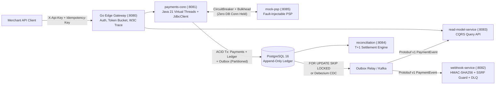

# PayCore Ledger — Production-Grade Payment Service & Double-Entry Ledger

**PayCore Ledger** is a payment orchestration platform and immutable double-entry financial ledger — the kind of core system that runs inside Stripe, Razorpay, or Juspay.

Built in **Java 21** (Spring Boot 3.3, Virtual Threads) and **Go 1.22** (Edge Gateway), backed by **PostgreSQL 16**, **Redpanda (Kafka-compatible)**, **Redis 7**, **Prometheus**, and **Grafana**.

Every design decision is driven by financial correctness under concurrency, crash safety, and measurable performance — not just clean code. Every claim is backed by a reproducible benchmark or test (see [`EVIDENCE.md`](EVIDENCE.md)).

Every architectural decision in PayCore is designed around **strict financial correctness (`ledger_drift_paise == 0`)**, **explicit concurrency control (`SELECT ... FOR UPDATE` in sorted account order)**, **connection-pool isolation across external I/O**, and **reproducible empirical proof** (see [`EVIDENCE.md`](file:///c:/Users/Asus/Desktop/ProjectsFInal/Paycore/EVIDENCE.md) and [`INTERVIEW_DEFENSE.md`](file:///c:/Users/Asus/Desktop/ProjectsFInal/Paycore/INTERVIEW_DEFENSE.md)).

---

## 1. System Architecture



---

## 2. Repository Module Structure

| Module / Directory | Language / Tech | Responsibility |
| :--- | :--- | :--- |
| [`gateway/`](file:///c:/Users/Asus/Desktop/ProjectsFInal/Paycore/gateway/main.go) | Go 1.22 (`net/http/httputil`) | Edge API gateway: SHA-256 `X-Api-Key` verification, per-merchant token-bucket rate limiter, `Idempotency-Key` enforcement on `POST`, W3C `traceparent` injection. |
| [`platform-common/`](file:///c:/Users/Asus/Desktop/ProjectsFInal/Paycore/platform-common/build.gradle.kts) | Java 21 + Protobuf v1 | Shared immutable [`Money`](file:///c:/Users/Asus/Desktop/ProjectsFInal/Paycore/platform-common/src/main/java/com/paycore/common/money/Money.java) (64-bit integer paise), monotonic [`UuidV7`](file:///c:/Users/Asus/Desktop/ProjectsFInal/Paycore/platform-common/src/main/java/com/paycore/common/ids/UuidV7.java), [`payment_events.proto`](file:///c:/Users/Asus/Desktop/ProjectsFInal/Paycore/platform-common/src/main/proto/paycore/events/v1/payment_events.proto) wire contract + CI compatibility task. |
| [`payments-core/`](file:///c:/Users/Asus/Desktop/ProjectsFInal/Paycore/payments-core/build.gradle.kts) | Java 21 / Spring Boot 3.3 | Two-phase payment authorization, capture, partial/full refunds, payouts, double-entry [`LedgerService`](file:///c:/Users/Asus/Desktop/ProjectsFInal/Paycore/payments-core/src/main/java/com/paycore/payments/ledger/LedgerService.java), [`IdempotencyService`](file:///c:/Users/Asus/Desktop/ProjectsFInal/Paycore/payments-core/src/main/java/com/paycore/payments/service/IdempotencyService.java), and [`OutboxPollingRelay`](file:///c:/Users/Asus/Desktop/ProjectsFInal/Paycore/payments-core/src/main/java/com/paycore/payments/outbox/OutboxPollingRelay.java). |
| [`webhook-service/`](file:///c:/Users/Asus/Desktop/ProjectsFInal/Paycore/webhook-service/build.gradle.kts) | Java 21 / Spring Boot 3.3 | Outbound merchant webhooks with HMAC-SHA256 signing (`X-PayCore-Signature`), DNS/IP SSRF validation, exponential backoff retries, and DLQ replay API. |
| [`read-model-service/`](file:///c:/Users/Asus/Desktop/ProjectsFInal/Paycore/read-model-service/build.gradle.kts) | Java 21 / Spring Boot 3.3 | Denormalized CQRS payment & statement views, `event_seq` gap detection & out-of-order buffer draining, UUIDv7 cursor pagination, and offset-0 projection rebuild. |
| [`reconciliation/`](file:///c:/Users/Asus/Desktop/ProjectsFInal/Paycore/reconciliation/build.gradle.kts) | Java 21 / Spring Boot 3.3 | T+1 settlement file reconciliation detecting `MISSING_IN_LEDGER`, `MISSING_IN_PSP_FILE`, `AMOUNT_MISMATCH`, and `STATUS_MISMATCH`. |
| [`mock-psp/`](file:///c:/Users/Asus/Desktop/ProjectsFInal/Paycore/mock-psp/build.gradle.kts) | Java 21 / Spring Boot 3.3 | Deterministic external Payment Service Provider simulator with latency, HTTP 5xx, and timeout fault injection. |
| [`e2e-tests/`](file:///c:/Users/Asus/Desktop/ProjectsFInal/Paycore/e2e-tests/build.gradle.kts) | Java 21 / Testcontainers | Cross-service Protobuf contract verification and **Toxiproxy** TCP latency & mid-transaction network cut chaos tests. |
| [`formal/`](file:///c:/Users/Asus/Desktop/ProjectsFInal/Paycore/formal/PayCoreLedger.tla) | TLA+ (`TLC`) | Formal state-machine specification verifying `ZeroGlobalLedgerDrift`, `RefundBoundedByCapture`, and `TerminalStateStability`. |
| [`deploy/`](file:///c:/Users/Asus/Desktop/ProjectsFInal/Paycore/deploy/docker-compose.lite.yml) | Docker Compose / K8s | 8-GB laptop-friendly `docker-compose.lite.yml`, Prometheus + Grafana dashboards/alerts, and `k3d` + CloudNativePG + Debezium manifests. |

---

## 3. Core Engineering Highlights

### 3.1 Three-Layer Double-Entry Ledger Protection
1. **Compile-Time / ArchUnit Boundary ([`ArchitectureBoundaryTest`](file:///c:/Users/Asus/Desktop/ProjectsFInal/Paycore/payments-core/src/test/java/com/paycore/payments/ArchitectureBoundaryTest.java))**:
   - No class outside `com.paycore.payments.ledger` can write to `ledger_entries` or call any internal ledger method other than `LedgerService.post(LedgerTransaction)`.
   - Service modules are prohibited at the Gradle build level from importing each other (`build.gradle.kts`); they share only `:platform-common`.
2. **Application-Level Sorted Locking & Balance Verification ([`LedgerService`](file:///c:/Users/Asus/Desktop/ProjectsFInal/Paycore/payments-core/src/main/java/com/paycore/payments/ledger/LedgerService.java))**:
   - Rejects unbalanced postings before touching the database.
   - Locks involved `accounts` rows via `SELECT ... FOR UPDATE` in **deterministic lexicographical order of `account_id`** to eliminate AB-BA deadlocks.
3. **Database-Level Triggers ([`V1__init_payments_core_schema.sql`](file:///c:/Users/Asus/Desktop/ProjectsFInal/Paycore/payments-core/src/main/resources/db/migration/V1__init_payments_core_schema.sql))**:
   - `trg_ledger_entries_append_only`: Rejects `UPDATE` and `DELETE` on `ledger_entries`.
   - `trg_verify_transaction_balanced`: `CONSTRAINT TRIGGER ... DEFERRABLE INITIALLY DEFERRED` verifies `SUM(DEBIT) == SUM(CREDIT)` for every `txn_id` at transaction `COMMIT`.

### 3.2 Two-Phase Payment Authorization (Zero DB Connection Held Across PSP I/O)
Holding a database transaction open across an external PSP HTTP call (80ms–2000ms) exhausts HikariCP connection pools under load. PayCore splits authorization into three short, non-blocking phases via [`IdempotencyService.executeTwoPhase`](file:///c:/Users/Asus/Desktop/ProjectsFInal/Paycore/payments-core/src/main/java/com/paycore/payments/service/IdempotencyService.java) and [`PaymentService.authorizePayment`](file:///c:/Users/Asus/Desktop/ProjectsFInal/Paycore/payments-core/src/main/java/com/paycore/payments/service/PaymentService.java):
- **Tx 1 (< 3ms)**: Reserve `(merchant_id, idempotency_key)` as `IN_PROGRESS` and insert payment in `CREATED` state. Commit & release JDBC connection.
- **External I/O (0 DB Connections Held)**: Call PSP inside Resilience4j CircuitBreaker + Retry + Bulkhead on a JDK 21 Virtual Thread.
- **Tx 2 (< 4ms)**: Re-lock payment row (`FOR UPDATE`), transition to `AUTHORIZED` (or `FAILED`), write `outbox_events` (`event_seq = 1`), and finalize idempotency response snapshot.

### 3.3 16-Way Hot-Account Sharding (`PSP_RECEIVABLE:INR:00..0f`)
In a naive ledger, every concurrent payment capture locks the single `PSP_RECEIVABLE:INR` row. PayCore shards `PSP_RECEIVABLE` into 16 sub-accounts (`00..0f`) selected deterministically via `MurmurHash3(paymentId) & 15`, reducing p50 capture latency by **`4.46x`** (`261ms` vs `1,165ms`) and p99 latency by **`4.51x`** (`392ms` vs `1,768ms`) under 64-thread contention.

---

## 4. Quickstart & Verification Commands

### Prerequisites
- **JDK 21** (Temurin 21)
- **Docker Desktop** (for Testcontainers PostgreSQL 16 + Toxiproxy)
- **Go 1.22+** (for `gateway/`)

### Run All JVM Verification Suites (Unit, Integration, Torture, jqwik, Benchmarks, Chaos E2E)
```powershell
.\gradlew.bat check --info
```

### Run Specific Verification Suites
```powershell
# 1. Concurrency & Crash Torture Suite (500 same-key, 200 captures, 100 partial refunds, 1000-iter fault loop)
.\gradlew.bat :payments-core:test --tests "com.paycore.payments.ConcurrencyAndCrashTortureTest" --info

# 2. jqwik Property-Based Ledger Invariant Suite
.\gradlew.bat :payments-core:test --tests "com.paycore.payments.LedgerPropertyTest" --info

# 3. 16-Shard vs Unsharded & Virtual Threads vs Platform Pool A/B Benchmarks
.\gradlew.bat :payments-core:test --tests "com.paycore.payments.StretchAbBenchmarkTest" --info

# 4. Toxiproxy Network Chaos & Protobuf Wire Contract E2E Suite
.\gradlew.bat :e2e-tests:test --info

# 5. Go Edge Gateway Security & Rate-Limiting Tests
cd gateway
go test -v -race ./...
```

### Start Local Lite Stack (PostgreSQL 16, Redpanda, Redis 7, Prometheus, Grafana)
```powershell
docker compose -f deploy/docker-compose.lite.yml up -d
```

---

## 5. Documentation Index
- **[`EVIDENCE.md`](file:///c:/Users/Asus/Desktop/ProjectsFInal/Paycore/EVIDENCE.md)** — Complete empirical benchmark tables, concurrency torture results, and invariant verification outputs.
- **[`INTERVIEW_DEFENSE.md`](file:///c:/Users/Asus/Desktop/ProjectsFInal/Paycore/INTERVIEW_DEFENSE.md)** — Staff-level engineering interview defense guide covering 12 deep-dive architectural questions and trade-offs.
- **[`openapi/paycore-openapi.yaml`](file:///c:/Users/Asus/Desktop/ProjectsFInal/Paycore/openapi/paycore-openapi.yaml)** — OpenAPI 3.1 contract for all public and internal endpoints.
- **[`formal/PayCoreLedger.tla`](file:///c:/Users/Asus/Desktop/ProjectsFInal/Paycore/formal/PayCoreLedger.tla)** — TLA+ formal specification of the payment and double-entry ledger state machine.
